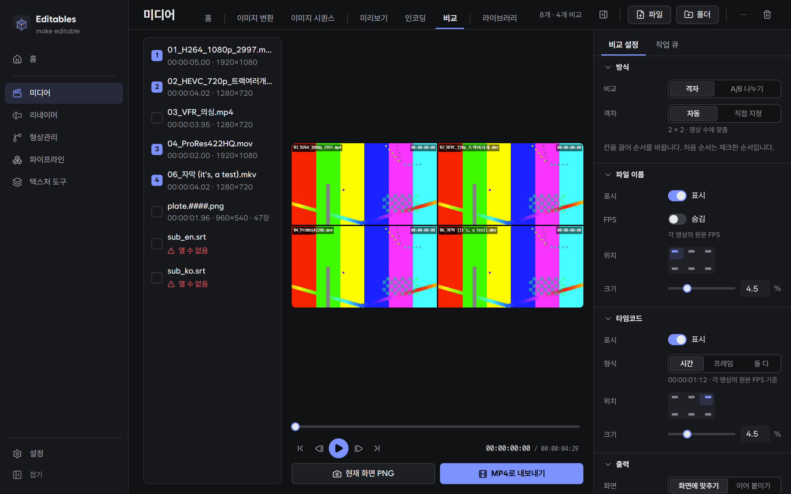
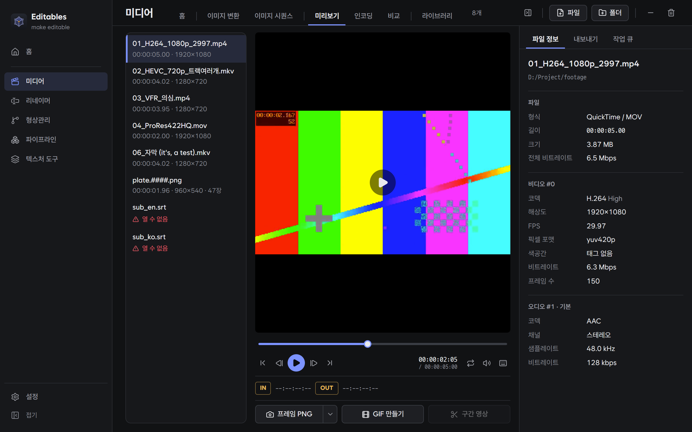
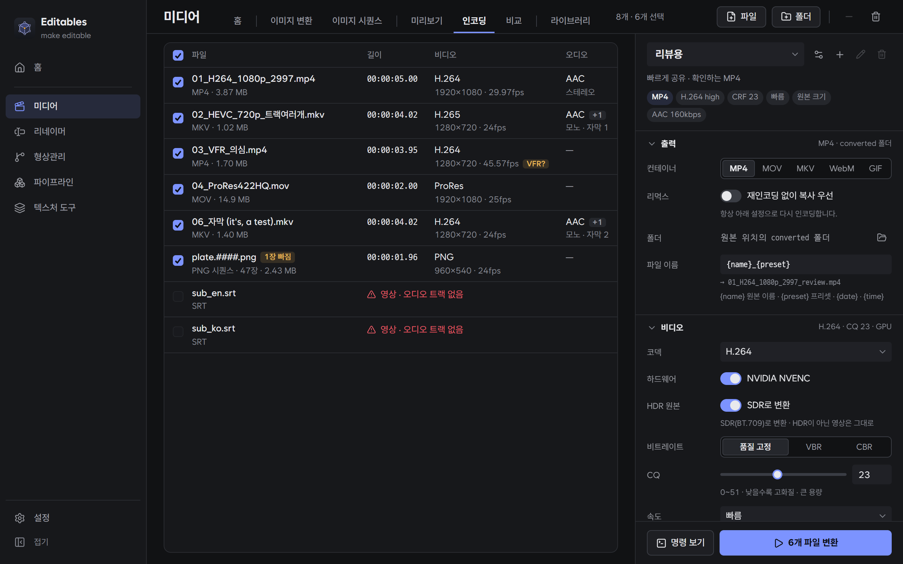
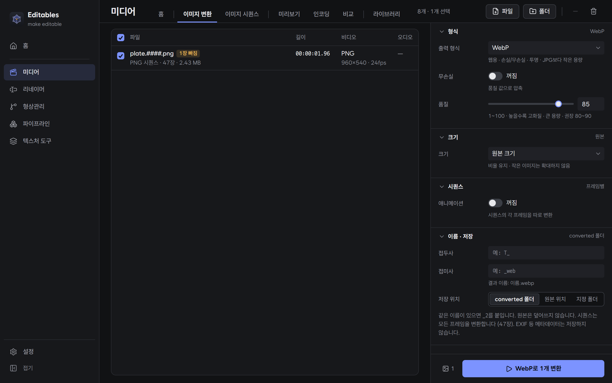
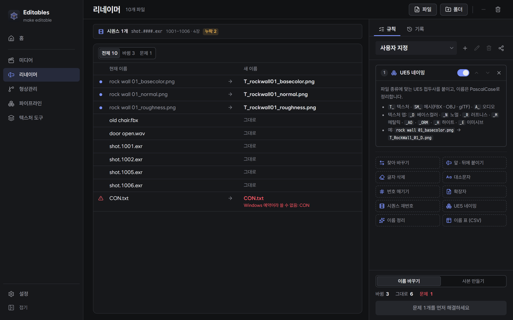
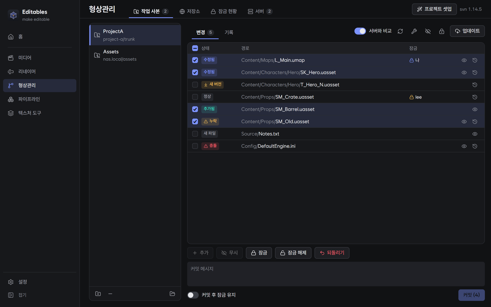
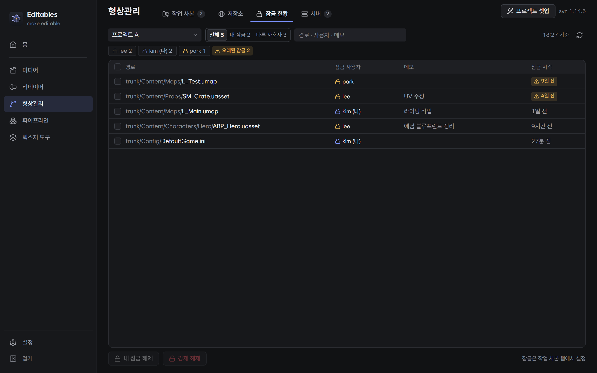
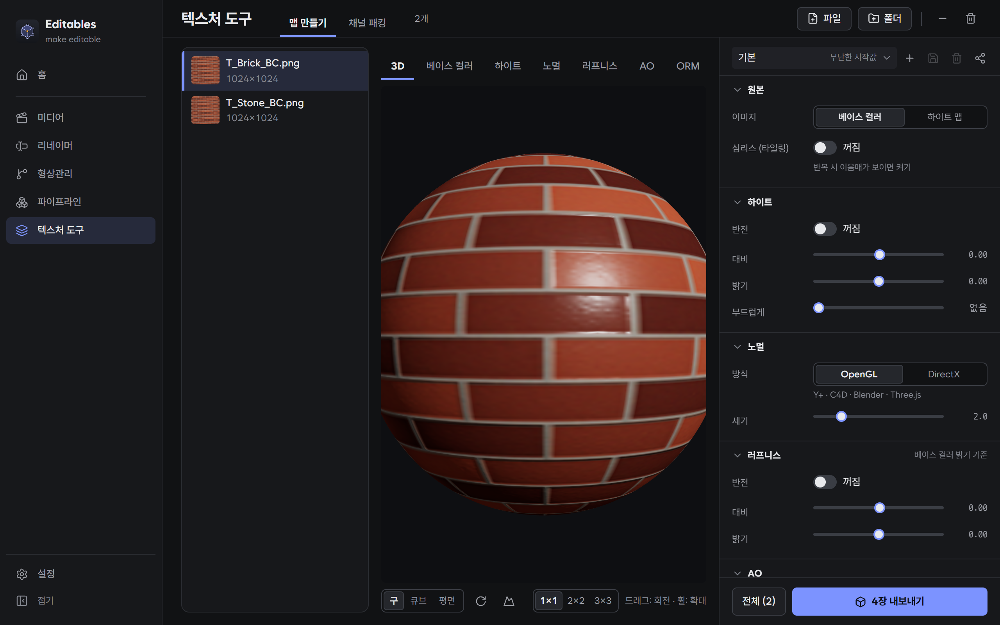
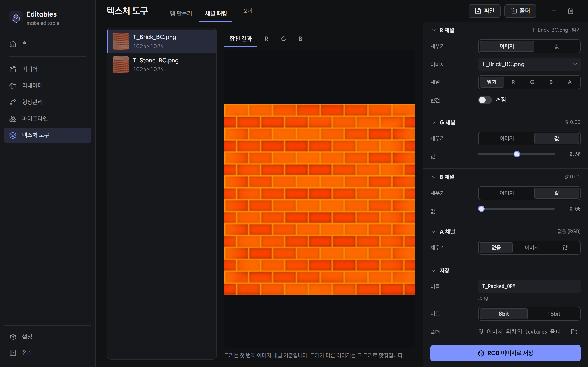
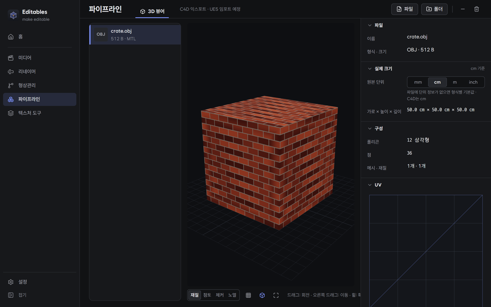

# Editables

스튜디오 make editable의 작업 도구입니다. 영상 · 이미지 변환, 파일 이름 일괄 변경, SVN 형상관리, 텍스처 맵 만들기, 3D 모델 확인을 한 앱에서 할 수 있습니다.



Windows · macOS(Apple Silicon)용이고, 무료로 쓸 수 있습니다.

## 기능

### 미디어

영상과 이미지를 확인하고 원하는 형식으로 바꿉니다.

미디어 화면은 파일 목록 하나로 미리보기 · 인코딩 · 비교를 오가며 씁니다.



- **미리보기**: 영상을 프레임 단위로 넘겨 보며 구간을 지정하고, 지금 화면을 PNG로 저장하거나 구간을 GIF · 영상으로 잘라 냅니다.
- **인코딩**: 여러 영상을 한 번에 MP4 · MOV · MKV · WebM · GIF로 변환합니다. 리뷰용 · 웹용 · 편집용 같은 프리셋을 고르기만 하면 되고, 오디오 · 자막 트랙도 골라 넣거나 자막을 영상에 입힐 수 있습니다.
- **이미지 시퀀스**: 영상을 PNG · JPG · TIFF · EXR 프레임으로 풀거나, 프레임 묶음을 영상으로 만듭니다. 빠진 프레임이 있으면 알려 줍니다.
- **이미지 변환**: 여러 이미지를 PNG · JPG · WebP · TIFF · AVIF 등으로 한 번에 바꾸고 크기 · 품질을 정합니다. 프레임 묶음은 움직이는 WebP 한 장으로도 만들 수 있습니다.
- **비교**: 여러 영상을 격자(최대 9칸)나 A/B 분할로 나란히 동시에 재생하고, 비교 화면을 영상 · 이미지로 저장합니다. 칸마다 파일 이름 · 타임코드(시간 · 프레임) · FPS를 원하는 위치에 표시합니다.
- **HDR 영상**: HDR(PQ · HLG) 영상은 SDR로 바꿔 미리보기 · 변환 · 비교하므로 물빠진 색으로 보이지 않습니다.
- **라이브러리**: 지금까지 변환한 기록을 날짜별로 보고, 결과 폴더를 열거나 같은 설정으로 다시 변환합니다.

<table>
<tr>
<td></td>
<td></td>
</tr>
<tr>
<td align="center">인코딩</td>
<td align="center">이미지 변환</td>
</tr>
</table>

### 리네이머

여러 파일의 이름을 규칙대로 한 번에 바꿉니다. 바뀔 이름을 미리 보고 적용하며, 적용한 뒤에도 되돌릴 수 있습니다.



- 글자 찾아 바꾸기 · 앞뒤에 붙이기 · 번호 매기기 · 대소문자 · 확장자 · 공백과 특수문자 정리
- **UE5 네이밍**: 파일 종류에 맞춰 `T_` · `SM_` · `A_` 접두사와 `_D` · `_N` · `_ORM` 같은 텍스처 접미사를 붙입니다.
- **시퀀스 재번호**: 프레임 번호를 0001부터 다시 매깁니다.
- **이름 표(CSV)**: 원래 이름과 새 이름을 엑셀로 정리한 표대로 바꿉니다.
- 원본은 그대로 두고 새 이름으로 **사본 만들기**도 할 수 있습니다.

### 형상관리 (SVN)

팀 저장소의 파일을 받고, 올리고, 잠급니다. Windows는 svn이 함께 설치되어 따로 준비할 것이 없습니다.



- **작업 사본**: 바뀐 파일 확인 · 커밋 · 업데이트 · 잠금 · 되돌리기 · 충돌 해결. 파일마다 바뀐 내용(텍스트 · 이미지)을 보거나 이전 버전을 받을 수 있습니다.
- **잠금 현황**: 저장소 전체에서 누가 어떤 파일을 잠갔는지 보고, 오래된 잠금을 정리합니다.
- **잠금 필수**: UE5 에셋(.uasset · .umap)은 잠근 사람만 수정할 수 있게 해, 두 사람이 같은 에셋을 동시에 고치는 일을 막습니다.
- **프로젝트 셋업**: 새 프로젝트를 받으면서 UE5에 맞는 무시 목록과 잠금 필수 설정까지 한 번에 끝냅니다.




### 텍스처 도구

베이스 컬러(또는 하이트) 이미지 한 장으로 PBR 맵을 만듭니다.



- 노멀 · 하이트 · 러프니스 · AO · ORM 맵을 만들고, 구 · 큐브 · 평면에 입혀 바로 확인합니다.
- **심리스**: 이어 붙여도 이음매가 보이지 않는 타일 텍스처로 만듭니다.
- **채널 패킹**: 여러 이미지의 채널을 골라 한 장으로 합칩니다.
- 언리얼 이름 규칙(`T_이름_N`)으로 PNG · TGA · TIFF를 저장합니다.




### 파이프라인



- **3D 뷰어**: FBX · OBJ · glTF · STL 모델을 열어 실제 크기 · 폴리곤 수 · 재질 · UV를 확인합니다.
- Cinema 4D 익스포트와 UE5 자동 임포트는 준비 중입니다.

### 그 밖에

- 자주 쓰는 설정은 프리셋으로 저장하고, 파일이나 팀 공유 폴더로 팀원과 함께 씁니다.
- 터미널 · 자동화 스크립트에서 쓰는 명령줄 도구(`editables-cli`)가 함께 설치됩니다.
- 긴 작업(변환 · 비교 · 텍스처 내보내기)이 끝나면 창이 뒤에 있어도 OS 알림으로 알려 줍니다.
- **설정 → 앱 정보 → 문제 보고**에서 의견 · 오류를 바로 보낼 수 있습니다. 진단 정보를 함께 보내면 원인을 찾기 쉽습니다.

## 설치

[Releases](https://github.com/ktk-ring/editables-releases/releases/latest)에서 운영체제에 맞는 파일을 받습니다.

| 운영체제 | 파일 |
| --- | --- |
| Windows 10 · 11 | `Editables-Setup-<버전>.exe` |
| macOS 12 이상 (Apple Silicon) | `Editables_<버전>_aarch64.dmg` |

그 밖의 파일(`Editables_<버전>_x64-setup.exe` · `*.app.tar.gz` · `*.sig` · `latest.json`)은 자동 업데이트에 쓰이므로 받지 않아도 됩니다.

### 처음 실행할 때

처음 한 번 운영체제가 확인 창을 띄웁니다.

- **Windows**: "Windows의 PC 보호" 창에서 **추가 정보 → 실행**을 누릅니다.
- **macOS**: DMG를 열어 Editables를 **응용 프로그램** 폴더로 끌어 놓은 뒤, 앱을 **우클릭 → 열기 → 열기**로 엽니다.
  - "손상되었기 때문에 열 수 없습니다"가 나오면 터미널에서 아래 명령을 실행한 뒤 다시 엽니다.

    ```bash
    xattr -dr com.apple.quarantine /Applications/Editables.app
    ```

### 외부 도구

영상 처리에 쓰는 FFmpeg와 svn은 앱과 따로 한 번만 설치됩니다. Windows 설치 파일에는 함께 들어 있고, macOS는 처음 켤 때 받습니다(약 120MB). 앱 업데이트 때는 다시 받지 않습니다.

## 업데이트

앱을 켜면 새 버전을 확인하고, 있으면 바뀐 점과 함께 알림 창을 띄웁니다. **설치 후 다시 시작**을 누르면 받는 동안 진행률이 보이고, 설치가 끝나면 앱이 자동으로 다시 시작됩니다. 알림 창을 닫아도 사이드바의 새 버전 표시나 **설정 → 앱 정보**에서 설치할 수 있습니다.

## 라이선스

- Editables는 무료로 내려받아 쓸 수 있습니다. 소스 코드는 공개하지 않으며, 오픈소스 라이선스는 부여하지 않습니다.
- 모든 권리는 make editable의 김태균에게 있습니다.
- 함께 들어 있는 외부 구성 요소의 라이선스는 [THIRD-PARTY-NOTICES.md](THIRD-PARTY-NOTICES.md)에 있습니다. 앱의 **설정 → 앱 정보 → 오픈소스 라이선스**에서도 볼 수 있습니다.
